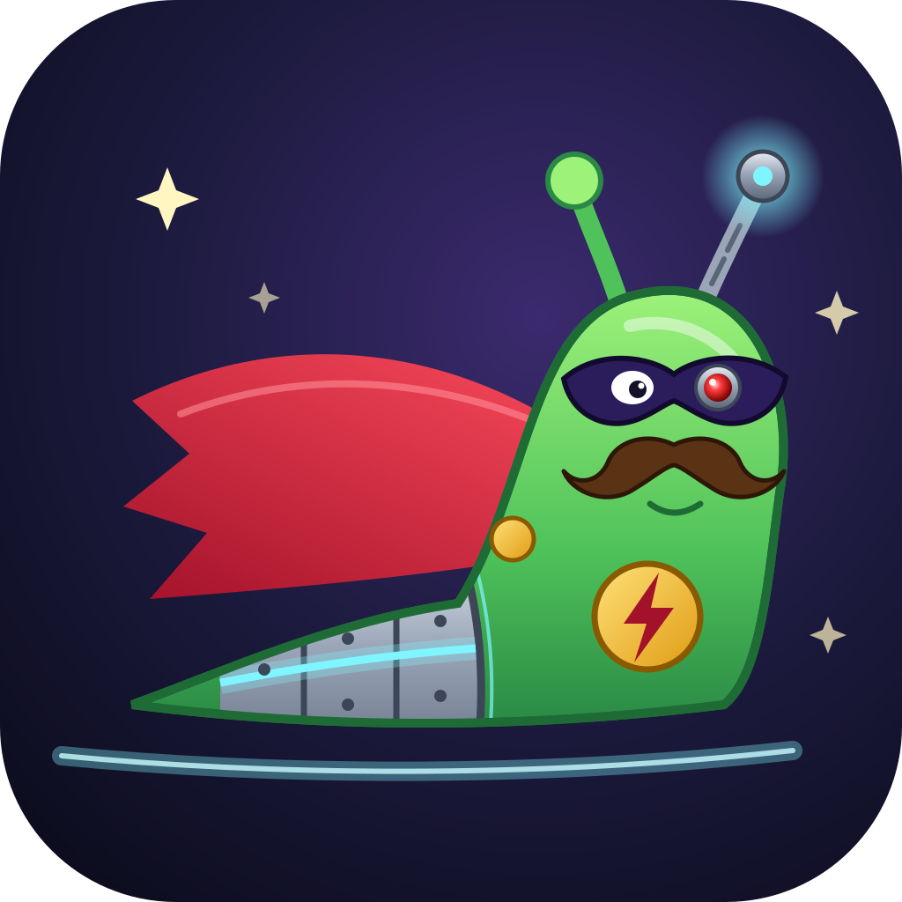

<p align="center"></p>

# noit-godot-skills

A Claude plugin for Godot 4.x game development (4.0–4.7). It gives Claude working knowledge of every major Godot system, current to **Godot 4.7.2**, and connects it to the [godot-mcp](https://github.com/alexmeckes/godot-mcp) tool server for reading, editing, running and testing projects.

Copyright (C) 2026 noit2.com. Licensed under the **GNU General Public License v3.0 or later**.

This project is built on [alexmeckes/godot-claude-skills](https://github.com/alexmeckes/godot-claude-skills) v1.0 (MIT) and fixes that version's defects and fills its gaps. The full credits chain is under [License & Credits](#license--credits) and in [NOTICE.md](NOTICE.md).

## What's Included

### Knowledge skills (picked automatically by topic)

| Skill | Covers |
|-------|--------|
| `godot-code-gen` | Typed GDScript, signals, state machines, Resources, async, tweens, and 4.4–4.7 language features (typed dictionaries, `@abstract`, variadic functions, `@export_tool_button`) |
| `godot-scene-design` | Node hierarchies, the `.tscn` format (including 4.6 `unique_id`), collision layer plans, instancing, procedural generation tools |
| `godot-shader` | canvas_item, spatial, particles and screen shaders; 4.5 stencil and shader baker; 4.7 HDR notes |
| `godot-project-architecture` | Folder layout, autoloads, event bus, components, data Resources, save/load, scene switching |
| `godot-physics` | Body types, layers and masks, CharacterBody controllers, queries, Jolt (default since 4.6), interpolation |
| `godot-ui` | Containers, anchors, themes, focus and gamepad navigation, scaling, 4.7 offset transforms and VirtualJoystick, accessibility |
| `godot-animation` | AnimationPlayer, AnimationTree, tweens (`tween_subtween`, `tween_await`), sections, 3D skeletons, 4.6 IK framework |
| `godot-input` | InputMap, event flow, mouse capture, gamepads (rumble, LED, 4.7 gyro), touch, rebinding |
| `godot-audio` | Bus layouts, players, pooling, adaptive music (Interactive/Synchronized/Playlist), volume settings |
| `godot-navigation` | Navmesh baking, agents, avoidance, links, AStarGrid2D, simple AI behaviors |
| `godot-multiplayer` | ENet/WebSocket/WebRTC, `@rpc`, spawners and synchronizers, authority, testing several instances |
| `godot-csharp` | .NET projects, naming map, signals and events, pitfalls, interop |
| `godot-testing` | GUT 9.x and GdUnit4 6.x, input simulation, headless CLI, exit codes, verified gotchas |
| `godot-export-ci` | Export templates and CLI, per-platform notes, signing secrets, a GitHub Actions workflow |
| `godot-performance` | Profilers (incl. Tracy/Perfetto, 4.6+), GDScript hot paths, pooling, MultiMesh, rendering, leaks |
| `godot-migration` | Godot 3 → 4, 4.x upgrades, and **generated API change references for 4.3 → 4.7.2** |
| `godot-live-edit` | Quick live-editor edits through the AI Bridge |
| `godot-interactive` | Persistent inspect → edit → run → verify loop through godot-mcp |

### Actions (run on request, e.g. `/godot-setup`)

| Skill | Does |
|-------|------|
| `godot-setup` | Finds Godot and the project version, installs and builds godot-mcp, installs and enables the AI Bridge, verifies the connection |
| `godot-check` | Parses all scripts, validates scenes, runs tests, scans for deprecated or too-new APIs, reports with file:line |

### Agent

| Agent | Does |
|-------|------|
| `godot-reviewer` | Independent review of new or changed code and scenes: correctness, version compatibility, performance, shipping hygiene |

### Hook

After Claude writes or edits a `.gd` file, the plugin parses it with your local Godot 4 binary (`--check-only`) and reports any parse errors back to Claude, so they get fixed straight away. If Godot isn't found, the hook does nothing.
- Set `GODOT_BIN=/path/to/godot` if Godot isn't on your PATH.
- Set `GODOT_CLAUDE_SKIP_CHECK=1` to turn the hook off.
- Files under `addons/` are skipped.

### Output style: Simplified English

The plugin includes the output style **Simplified English** (`output-styles/simplified-english.md`). It makes Claude write all prose in clear, consistent English, based on the principles of ASD-STE100 Simplified Technical English:
- one word for one meaning, with a glossary of approved terms
- the active voice and simple tenses
- a maximum of 20 words in an instruction and 25 words in a description
- the conclusion first, then the reasons
- an owner and a due date for each action

The rules apply to prose only. Code, commands and file names stay exactly as they are.

To use it, select **Simplified English** with `/output-style`. To add your company terms, edit the glossary table in section 8 of the file.

### MCP server

**This plugin does not include the godot-mcp server.** It ships only a launcher (`scripts/start-godot-mcp.sh`) that starts your own install of the separate [alexmeckes/godot-mcp](https://github.com/alexmeckes/godot-mcp) project (99 tools: scenes, scripts, shaders, animation, input, audio, navigation, UI, procedural generation, live editor control and runtime automation) for the Godot project in your working folder. Until you install it, the server shows as failed and the skills work from files only. Install it once, then restart Claude:

```bash
git clone https://github.com/alexmeckes/godot-mcp ~/godot-mcp
cd ~/godot-mcp && npm install && npm run build
```

The launcher looks for godot-mcp in `$GODOT_MCP_DIR`, `~/godot-mcp`, `~/.local/share/godot-mcp`, or `godot-mcp` on PATH. Optional settings:

| Variable | Purpose |
|----------|---------|
| `GODOT_MCP_DIR` | Path to a godot-mcp checkout |
| `GODOT_PROJECT` | Godot project folder (default: nearest folder with `project.godot`) |
| `GODOT_BRIDGE_PORT` | AI Bridge port if not 6550 |

For live editing and runtime automation, also copy `addons/godot_ai_bridge` from godot-mcp into your project and enable it. `/godot-setup` does this for you after asking. **Exclude the bridge from release exports.**

## Requirements

- Claude with plugin support
- [Godot 4.x](https://godotengine.org/download) (4.7.2 recommended; skills note version differences back to 4.3)
- Node.js, for godot-mcp and the parse-check hook
- Optional: GUT or GdUnit4 for tests

## Installation

```bash
/plugin marketplace add Yuki-az-23/noit-godot-skills
/plugin install noit-godot-skills@noit-godot-skills
```
Local development: `claude --plugin-dir ./noit-godot-skills`. In the Claude app, install the packaged `.plugin` file.

## Plugin Structure

```
noit-godot-skills/
├── .claude-plugin/        plugin.json, marketplace.json
├── .mcp.json              starts godot-mcp via scripts/start-godot-mcp.sh
├── output-styles/         simplified-english.md (writing protocol)
├── assets/                icon.svg (mascot source; PNG in .claude-plugin/)
├── agents/                godot-reviewer.md
├── hooks/                 hooks.json, check-gdscript.mjs
├── scripts/               start-godot-mcp.sh, api_diff.py
├── skills/                20 skills (see above); godot-migration/references/ holds the API diffs
├── licenses/              upstream MIT licenses (godot-claude-skills, godot-mcp, Godot)
├── LICENSE                GNU GPL v3 (this project)
└── NOTICE.md              copyright, credits chain, changes
```

## Regenerating the API References

`scripts/api_diff.py` builds the change lists from Godot's class reference XML. For a new release (for example 4.8):

```bash
# Get doc XML for two tags (sparse clone keeps it small)
for t in 4.7.2-stable 4.8-stable; do
  git clone -q --depth 1 --branch $t --filter=blob:none --no-checkout https://github.com/godotengine/godot docs-src/$t
  (cd docs-src/$t && git sparse-checkout set --no-cone '/doc/classes/' '/modules/*/doc_classes/' && git checkout -q $t)
done
python3 scripts/api_diff.py docs-src 4.7.2-stable 4.8-stable > skills/godot-migration/references/api-4.7-to-4.8.md
```
Then add the new file to the table in `skills/godot-migration/SKILL.md`.

## License & Credits

```
noit-godot-skills — Godot 4.x skill pack for Claude
Copyright (C) 2026 noit2.com

This program is free software: you can redistribute it and/or modify
it under the terms of the GNU General Public License as published by
the Free Software Foundation, either version 3 of the License, or
(at your option) any later version.

This program is distributed in the hope that it will be useful,
but WITHOUT ANY WARRANTY; without even the implied warranty of
MERCHANTABILITY or FITNESS FOR A PARTICULAR PURPOSE.  See the
GNU General Public License for more details.

You should have received a copy of the GNU General Public License
along with this program.  If not, see <https://www.gnu.org/licenses/>.
```

### Credits chain

This project stands on the following work. Each one's own license and copyright stay attached to it.

| # | Project | Copyright | License | How it's used here | License text |
|---|---------|-----------|---------|--------------------|--------------|
| 1 | **noit-godot-skills** (this project) | © 2026 noit2.com | GPL-3.0-or-later | v2.0 fixes, 15 new skills, agent, hook, MCP launcher, API diff tool | [`LICENSE`](LICENSE) |
| 2 | [godot-claude-skills](https://github.com/alexmeckes/godot-claude-skills) v1.0 | © 2025 (author: Alex Meckes) | MIT | Starting point: the 5 original skills, modified | [`licenses/MIT-godot-claude-skills.txt`](licenses/MIT-godot-claude-skills.txt) |
| 3 | [Godot Engine](https://github.com/godotengine/godot) | © 2014-present Godot Engine contributors; © 2007-2014 Juan Linietsky, Ariel Manzur | MIT | API change references derived from its class reference XML (4.3 → 4.7.2) | [`licenses/GODOT-LICENSE.txt`](licenses/GODOT-LICENSE.txt) |
| 4 | [godot-mcp](https://github.com/alexmeckes/godot-mcp) | © 2026 Alex Meckes | MIT | Tool server launched if you install it; tool names documented. Not bundled. | [`licenses/MIT-godot-mcp.txt`](licenses/MIT-godot-mcp.txt) |
| 5 | [GUT](https://github.com/bitwes/Gut) | © 2018 Tom "Butch" Wesley | MIT | Documented test framework. Not bundled. | upstream repo |
| 6 | [GdUnit4](https://github.com/godot-gdunit-labs/gdUnit4) | © 2023-2026 Mike Schulze | MIT | Documented test framework. Not bundled. | upstream repo |
| 7 | [GNU GPL v3 text](https://www.gnu.org/licenses/gpl-3.0.txt) | © 2007 Free Software Foundation | verbatim copying permitted | [`LICENSE`](LICENSE) | — |

MIT allows its code to be included in a GPL project. The MIT notices above must stay with the parts they cover, which is why they're kept in `licenses/`. The combined work is distributed under GPLv3.

### Reusing or forking this project

To comply with GPLv3 (sections 4–6) when you share a copy or a modified version:

1. **Keep the license:** ship `LICENSE` (GPLv3) and the whole `licenses/` folder unchanged.
2. **Keep the notices:** don't remove the copyright lines in this README, `NOTICE.md`, or the `SPDX-License-Identifier` headers in `hooks/`, `scripts/`.
3. **Mark your changes:** add your own line under "Changes" in `NOTICE.md` (who, when, what), and a `Copyright (C) <year> <you>` line for your modifications.
4. **Keep it open:** your modified version must also be GPL-3.0-or-later, and you must offer its source (a public repo is enough).
5. **Add to the chain:** add a row to the credits table above for any new third-party work you include, with its license text in `licenses/`.
6. **No extra restrictions:** you can't add terms that take away rights GPLv3 gives.

Using the plugin, including in commercial game projects, places no obligation on your games. The GPL covers this plugin's own files, not the code Claude writes for you with it.

"Godot" and the Godot logo are trademarks of the Godot Foundation. This is a community project, not affiliated with or endorsed by the Godot Foundation or Anthropic.
